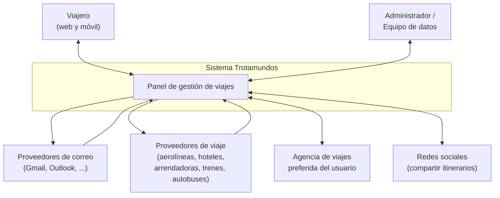

# Diagrama de contexto

Diagrama de contexto del sistema **Trotamundos**. Muestra el límite del sistema (la caja central)
y los actores o sistemas externos con los que interactúa. Se conserva además la versión gráfica
original en [`diagrama_de_contexto.png`](./diagrama_de_contexto.png).

> **Inferencia / decisión consciente.** La versión Mermaid siguiente se reconstruyó a partir de la
> descripción textual de [`../Analisis_y_pre-requisitos.md`](../Analisis_y_pre-requisitos.md) y del
> enunciado, dado que la imagen original no pudo ser leída automáticamente. No agrega actores ni
> interacciones nuevas respecto de lo ya documentado por el equipo.

## Cómo leerlo

- El rectángulo **Sistema Trotamundos** marca el sistema que se diseña.
- El resto son actores o sistemas externos que quedan **fuera del límite**.
- Las flechas indican sentidos de interacción requeridos o necesarios según los casos descritos;
  no representan una API ya implementada.

## Referencias

- [`../Analisis_y_pre-requisitos.md`](../Analisis_y_pre-requisitos.md)
- [`../ADD_borrador_inicial.md`](../ADD_borrador_inicial.md)
