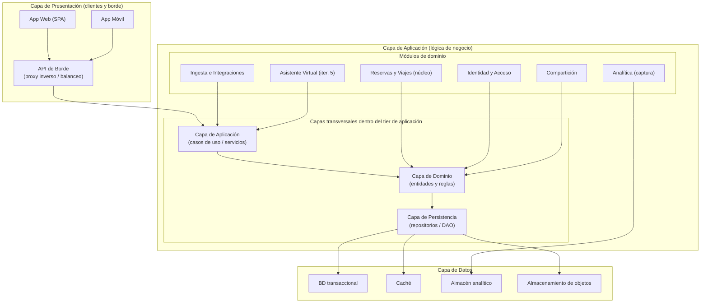

# Iteración 1 — Vista de capas y módulos

Vista de **módulos** (module view) que muestra la organización lógica del tier de aplicación en
capas internas y los módulos de dominio que las habitan. Corresponde a la Iteración 1 del método
ADD (estructura general del sistema).

Fundamento (bibliografía): *Reference architecture for Web Applications* (presentation, business,
data) y patrón **Layers** (Cervantes & Kazman, *Designing Software Architectures*, cap. 2–3 y
Apéndice A).

## Catálogo de elementos

#### App Web (SPA)
- Interfaz del viajero en navegador; consume la API de borde.

#### App Móvil
- Interfaz del viajero en dispositivo móvil; aprovecha capacidades nativas (GPS).

#### API de Borde
- Punto único de entrada; proxy inverso, balanceo, terminación TLS y autenticación superficial.

#### Módulos de dominio
- **Identidad y Acceso:** autenticación, autorización y gestión de usuarios.
- **Reservas y Viajes:** núcleo; agrupa reservas por viaje, gestión manual y ciclo de vida.
- **Ingesta e Integraciones:** procesamiento de correo y de proveedores externos mediante adaptadores.
- **Compartición:** control de acceso a itinerarios compartidos.
- **Analítica:** captura de eventos; las consultas pesadas se delegan al almacén analítico.
- **Asistente Virtual:** se incorpora en la Iteración 5.

#### Capas internas del tier de aplicación
- **Aplicación:** casos de uso u orquestación.
- **Dominio:** entidades y reglas de negocio.
- **Persistencia:** acceso a datos (repositorios/DAO).

## Decisiones relacionadas
- [MADR-0001 Estilo de arquitectura general](../MADR/MADR-0001-estilo-arquitectura-general.md)
- [MADR-0002 Descomposición en módulos de dominio](../MADR/MADR-0002-descomposicion-modulos-dominio.md)

## Vistas relacionadas
- [Iteración 1 — Vista de componentes y conectores general](./iter1_cc_general.md)
- [Iteración 1 — Vista de despliegue](./iter1_despliegue.md)
