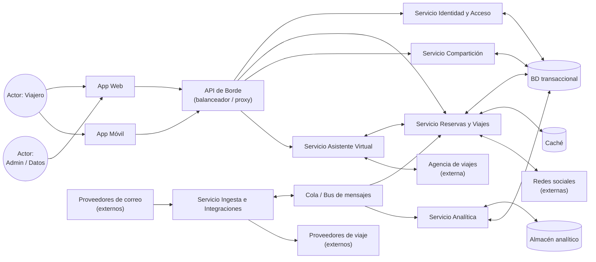

# Iteración 1 — Vista de componentes y conectores (general)

Vista de **componentes y conectores** (C&C) que muestra los elementos en tiempo de ejecución y sus
conectores en la estructura general del sistema, antes de refinar cada módulo. Corresponde a la
Iteración 1 del método ADD.

## Catálogo de elementos

#### Actores
- **Viajero:** consulta y gestiona sus viajes desde web o móvil.
- **Admin / Datos:** administración y consumo de analítica.

#### Componentes de presentación
- **App Web**, **App Móvil:** clientes que consumen la API de borde.
- **API de Borde:** punto de entrada; balancea y enruta hacia los servicios internos.

#### Componentes de lógica
- **Servicio Identidad y Acceso**, **Servicio Reservas y Viajes**, **Servicio Ingesta e
  Integraciones**, **Servicio Compartición**, **Servicio Analítica** y **Servicio Asistente
  Virtual** (incorporado en la Iteración 5).

#### Conectores
- **Colea / Bus de mensajes:** conector asíncrono para desacoplar la ingesta de la persistencia.
- **Llamadas REST/HTTPS:** conector síncrono entre borde, servicios y clientes.
- **Conectores de datos:** acceso a BD transaccional, caché y almacén analítico.

#### Sistemas externos
- Proveedores de viaje, proveedores de correo, agencia de viajes y redes sociales.

## Decisiones relacionadas
- [MADR-0001 Estilo de arquitectura general](../MADR/MADR-0001-estilo-arquitectura-general.md)
- [MADR-0004 Procesamiento asíncrono con mensajería](../MADR/MADR-0004-procesamiento-asincrono-mensajeria.md)

## Vistas relacionadas
- [Iteración 1 — Vista de capas y módulos](./iter1_capas.md)
- [Iteración 1 — Vista de despliegue](./iter1_despliegue.md)
