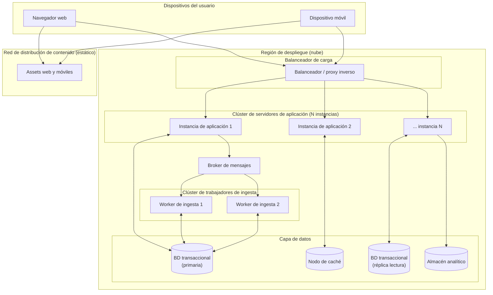

# Iteración 1 — Vista de despliegue

Vista de **asignación** (allocation / deployment view). Muestra cómo los elementos lógicos se mapean
sobre nodos físicos siguiendo el patrón de despliegue **Distributed Deployment** con
**Load-Balanced Cluster** (Cervantes & Kazman, Apéndice A.2).

## Catálogo de elementos

#### Balanceador de carga
- Distribuye solicitudes entre las instancias de aplicación; primera línea de disponibilidad y escalado horizontal.

#### Clúster de servidores de aplicación
- Varias instancias sin estado que ejecutan la lógica de negocio. Permiten escalar horizontalmente y tolerar la caída de una instancia.

#### Clúster de trabajadores de ingesta
- Consumen mensajes del broker y procesan actualizaciones de correo y proveedores.

#### Capa de datos
- **BD transaccional (primaria + réplica de lectura):** persistencia del núcleo y descarga de lecturas.
- **Nodo de caché:** acelera consultas repetidas.
- **Almacén analítico:** aísla las consultas analíticas pesadas.

#### Broker de mensajes
- Desacopla productores (ingesta) de consumidores (reservas, analítica).

#### Red de distribución de contenido
- Sirve los recursos estáticos de web y móvil para mejorar el arranque (FCP).

> **Inferencia / decisión consciente.** El número de instancias y la tecnología concreta de cada nodo
> no están especificados en la consigna; se representan de forma genérica. La elección de un
> proveedor de nube y de servicios gestionados se deja como decisión abierta (ver backlog).

## Decisiones relacionadas
- [MADR-0001 Estilo de arquitectura general](../MADR/MADR-0001-estilo-arquitectura-general.md)
- [MADR-0008 Estrategia de caché y CDN](../MADR/MADR-0008-estrategia-cache-cdn.md)

## Vistas relacionadas
- [Iteración 1 — Vista de capas y módulos](./iter1_capas.md)
- [Iteración 1 — Vista de componentes y conectores general](./iter1_cc_general.md)
