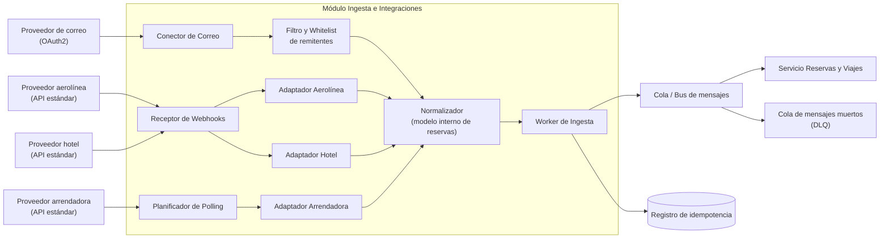

# Iteración 2 — Vista de componentes y conectores (ingesta e integraciones)

Vista C&C del módulo **Ingesta e Integraciones**, refinado en la Iteración 2. Aplica el patrón
**Ports & Adapters (Hexagonal)**, **Adapter / Anticorruption Layer (Wrapper)** y mensajería
asíncrona (**Half-Sync/Half-Async**).

## Catálogo de elementos

#### Receptor de Webhooks
- Recibe notificaciones *push* de los proveedores que las soportan (actualizaciones/cancelaciones).

#### Planificador de Polling
- Sondea periódicamente a los proveedores que **no** ofrecen webhooks.

#### Conector de Correo
- Accede a los mensajes autorizados mediante OAuth2 con permisos mínimos.

#### Adaptadores (Aerolínea, Hotel, Arrendadora)
- Encapsulan cada API externa y traducen su contrato al modelo interno (patrón Adapter/ACL).

#### Normalizador
- Traduce las distintas representaciones externas a un **modelo interno de reservas**.

#### Filtro y Whitelist de remitentes
- Descarta correos no relacionados y respeta las listas de remitentes seguros (RF-07).

#### Worker de Ingesta
- Procesa los eventos normalizados de forma asíncrona, idempotente, y los publica en la cola.

#### Cola / Bus de mensajes
- Desacopla la recepción de la persistencia; absorbe picos y tolera caídas temporales.

#### Registro de idempotencia
- Evita procesar dos veces la misma actualización.

#### Cola de mensajes muertos (DLQ)
- Retiene eventos que no pudieron procesarse tras los reintentos, para inspección.

## Behavior
- Ver [Iteración 2 — Secuencia de actualización externa](./iter2_secuencia_actualizacion.md).

## Decisiones relacionadas
- [MADR-0003 Enfoque de integración externa](../MADR/MADR-0003-enfoque-integracion-externa.md)
- [MADR-0004 Procesamiento asíncrono con mensajería](../MADR/MADR-0004-procesamiento-asincrono-mensajeria.md)
- [MADR-0005 Patrón adaptador / capa anticorrupción](../MADR/MADR-0005-patron-adaptador-acl.md)
- [MADR-0006 Acceso seguro al correo](../MADR/MADR-0006-acceso-seguro-correo.md)

## Vistas relacionadas
- [Iteración 1 — Vista de componentes y conectores general](./iter1_cc_general.md)
- [Iteración 4 — Vista de seguridad y analítica](./iter4_cc_seguridad_analitica.md)
