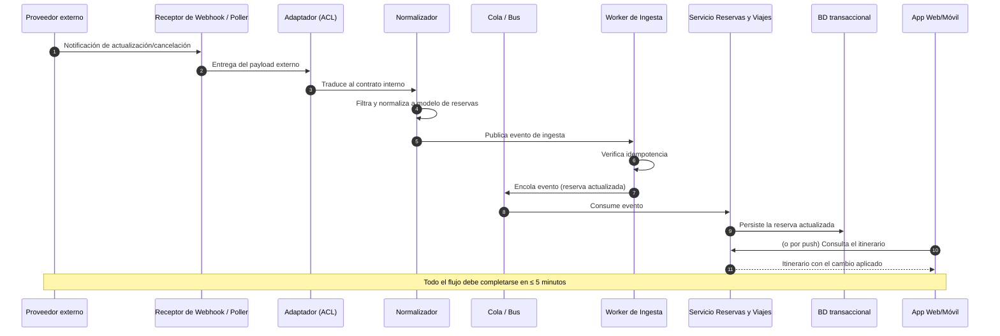

# Iteración 2 — Secuencia: actualización externa presentada ≤ 5 min

Diagrama de secuencia para el escenario **QA-03**: una fuente externa genera una actualización y el
sistema debe presentarla en la aplicación dentro de los 5 minutos.

## Notas

- El límite de 5 minutos (QA-03) admite procesamiento **asíncrono**: no exige consistencia inmediata
  con la fuente externa.
- Si un proveedor no ofrece webhooks, el planificador de polling debe configurarse con una
  periodicidad que deje margen suficiente dentro de la ventana de 5 minutos.
- Los eventos que fallen repetidamente van a la DLQ (ver vista C&C de ingesta).

> **Inferencia / decisión consciente.** El detalle exacto de periodicidad de polling, número de
> reintentos y política de *backoff* no está especificado por la consigna; se fija en función de la
> ventana de 5 minutos de QA-03 y se deja como parámetro configurable.

## Decisiones relacionadas
- [MADR-0003 Enfoque de integración externa](../MADR/MADR-0003-enfoque-integracion-externa.md)
- [MADR-0004 Procesamiento asíncrono con mensajería](../MADR/MADR-0004-procesamiento-asincrono-mensajeria.md)

## Vistas relacionadas
- [Iteración 2 — Vista de componentes y conectores de ingesta](./iter2_cc_ingesta.md)
