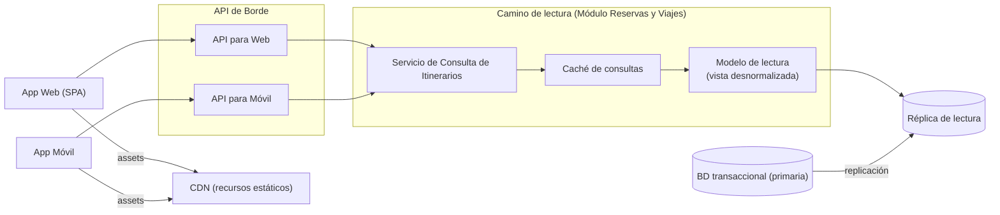

# Iteración 3 — Vista de componentes y conectores (acceso web/móvil)

Vista C&C del camino de acceso del usuario, refinado en la Iteración 3. Aplica **cacheo**,
**CDN**, **réplicas de lectura** y una capa de API dedicada por tipo de cliente
(*Interface Partitioning* / Backend for Frontends).

## Catálogo de elementos

#### API para Web y API para Móvil
- Contratos adaptados a cada tipo de cliente (formatos, payloads y capacidades distintas).

#### Servicio de Consulta de Itinerarios
- Atiende las lecturas del panel; responde en el camino de lectura optimizado.

#### Caché de consultas
- Guarda resultados de consultas frecuentes para responder por debajo del umbral de QA-01.

#### Modelo de lectura (vista desnormalizada)
- Estructura optimizada para lecturas (reservas agrupadas por viaje) que evita *joins* costosos.

#### Réplica de lectura
- Descarga las consultas de la BD transaccional primaria.

#### CDN
- Entrega los recursos estáticos para reducir el tiempo de primer contenido visible (QA-02).

## Behavior
- Ver [Iteración 3 — Secuencia de consulta web < 800 ms](./iter3_secuencia_consulta_web.md).

## Decisiones relacionadas
- [MADR-0007 Arquitectura de presentación](../MADR/MADR-0007-arquitectura-presentacion.md)
- [MADR-0008 Estrategia de caché y CDN](../MADR/MADR-0008-estrategia-cache-cdn.md)
- [MADR-0009 Modelo de lectura y réplicas](../MADR/MADR-0009-read-model-replicas.md)
- [MADR-0010 Internacionalización y multiregión](../MADR/MADR-0010-internacionalizacion-multiregion.md)

## Vistas relacionadas
- [Iteración 1 — Vista de componentes y conectores general](./iter1_cc_general.md)
- [Iteración 4 — Vista de seguridad y analítica](./iter4_cc_seguridad_analitica.md)
