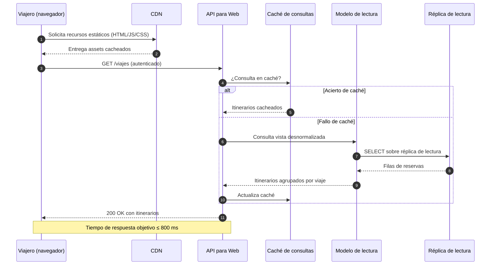

# Iteración 3 — Secuencia: consulta web con respuesta ≤ 800 ms

Diagrama de secuencia para el escenario **QA-01** (tiempo de respuesta web de 800 ms) y, en el
arranque, **QA-02** (FCP móvil < 1,4 s).

## Notas

- El camino de lectura evita tocar la BD primaria, reduciendo la contención.
- La CDN favorece el primer contenido visible (FCP) en móvil (QA-02).
- El caché introduce **consistencia eventual**: debe definirse un tiempo de vida (TTL) e
  invalidación ante escrituras.

> **Inferencia / decisión consciente.** La consigna no define si los 800 ms son máximo, promedio o
> percentil, ni el TTL del caché. Se adoptan valores conservadores configurables y se deja anotado
> como riesgo/brecha.

## Decisiones relacionadas
- [MADR-0008 Estrategia de caché y CDN](../MADR/MADR-0008-estrategia-cache-cdn.md)
- [MADR-0009 Modelo de lectura y réplicas](../MADR/MADR-0009-read-model-replicas.md)

## Vistas relacionadas
- [Iteración 3 — Vista de componentes y conectores de acceso](./iter3_cc_acceso.md)
