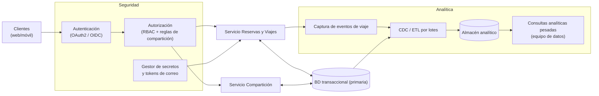

# Iteración 4 — Vista de componentes y conectores (seguridad y analítica)

Vista C&C que refina los módulos **Identidad y Acceso**, **Compartición** y **Analítica** en la
Iteración 4. Aplica tácticas de seguridad (autenticación, autorización, cifrado, mínimo privilegio)
y aísla la analítica pesada en un almacén dedicado alimentado por CDC/ETL.

## Catálogo de elementos

#### Autenticación (OAuth2 / OIDC)
- Verifica la identidad del usuario; puede apoyarse en un proveedor de identidad externo.

#### Autorización (RBAC + reglas de compartición)
- Decide si un solicitante puede ver un itinerario; para itinerarios compartidos aplica reglas
  específicas de designación (QA-07).

#### Gestor de secretos y tokens de correo
- Almacena credenciales/refresh tokens de correo de forma cifrada y permite su revocación (QA-08).

#### Captura de eventos de viaje
- Emite eventos de dominio (reserva creada/actualizada, viaje completado) para analítica.

#### CDC / ETL por lotes
- Sincroniza datos transaccionales hacia el almacén analítico sin afectar la operación en línea.

#### Almacén analítico + consultas pesadas
- Aísla las consultas analíticas (RF-09) del camino transaccional, protegiendo el rendimiento en línea.

## Behavior
- Ver [Iteración 4 — Secuencia de acceso a itinerario compartido](./iter4_secuencia_itinerario_compartido.md).

## Decisiones relacionadas
- [MADR-0011 Autenticación y autorización](../MADR/MADR-0011-autenticacion-autorizacion.md)
- [MADR-0012 Aislamiento de la analítica](../MADR/MADR-0012-aislamiento-analitica.md)
- [MADR-0013 Cifrado y gestión de secretos](../MADR/MADR-0013-cifrado-gestion-secretos.md)

## Vistas relacionadas
- [Iteración 3 — Vista de componentes y conectores de acceso](./iter3_cc_acceso.md)
- [Iteración 2 — Vista de componentes y conectores de ingesta](./iter2_cc_ingesta.md)
