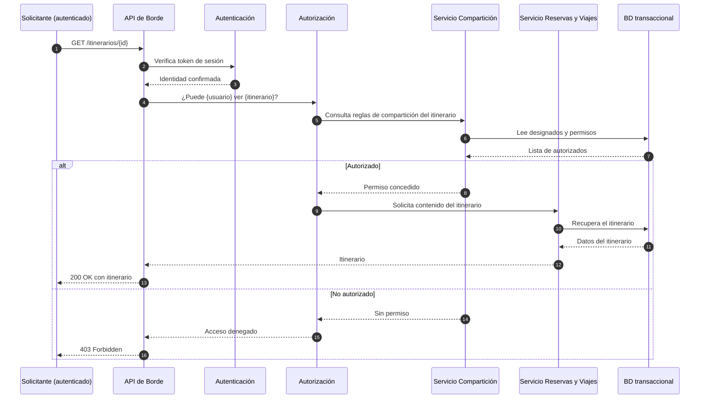

# Iteración 4 — Secuencia: acceso a un itinerario compartido

Diagrama de secuencia para el escenario **QA-07**: solo las personas específicamente designadas
pueden visualizar un itinerario.

## Notas

- La autorización se resuelve de forma centralizada y auditable.
- El acceso denegado debe registrarse en una traza de auditoría.
- El compartir itinerarios no debe exponer datos de correo ni credenciales.

## Decisiones relacionadas
- [MADR-0011 Autenticación y autorización](../MADR/MADR-0011-autenticacion-autorizacion.md)

## Vistas relacionadas
- [Iteración 4 — Vista de seguridad y analítica](./iter4_cc_seguridad_analitica.md)
