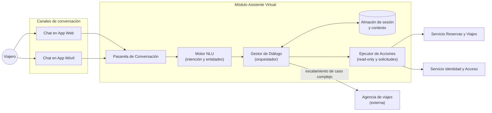

# Iteración 5 — Vista de componentes y conectores (Asistente Virtual / Chatbot)

Vista C&C del módulo **Asistente Virtual** (Opción B), incorporado en la Iteración 5. El bot es el
primer nivel de soporte para reprogramaciones, consultas de estado y problemas menores, y delega
los casos complejos a la agencia de viajes preferida del usuario (RF-06, RF-08).

## Catálogo de elementos

#### Pasarela de Conversación
- Punto de entrada único de los canales; normaliza el protocolo de mensajes.

#### Motor NLU
- Interpreta la intención y extrae entidades del mensaje del usuario.

#### Gestor de Diálogo (orquestador)
- Mantiene el estado de la conversación y decide el siguiente paso o el escalamiento.

#### Almacén de sesión y contexto
- Guarda el contexto de la conversación (con expiración).

#### Ejecutor de Acciones
- Invoca capacidades del dominio (consultar estado, solicitar reprogramación).

#### Agencia de viajes (externa)
- Recibe los casos complejos mediante escalamiento (*handoff*).

> **Inferencia / decisión consciente.** La tecnología concreta del motor NLU (construir vs. comprar)
> es una decisión abierta; ver [MADR-0016](../MADR/MADR-0016-build-vs-buy-nlu.md).

## Behavior
- Ver [Iteración 5 — Secuencia de conversación y handoff](./iter5_secuencia_handoff.md).

## Decisiones relacionadas
- [MADR-0014 Arquitectura del asistente virtual](../MADR/MADR-0014-arquitectura-asistente-virtual.md)
- [MADR-0015 Integración del chatbot y handoff](../MADR/MADR-0015-integracion-chatbot-handoff.md)
- [MADR-0016 Decisión build vs. buy del NLU](../MADR/MADR-0016-build-vs-buy-nlu.md)

## Vistas relacionadas
- [Iteración 1 — Vista de componentes y conectores general](./iter1_cc_general.md)
- [Iteración 4 — Vista de seguridad y analítica](./iter4_cc_seguridad_analitica.md)
