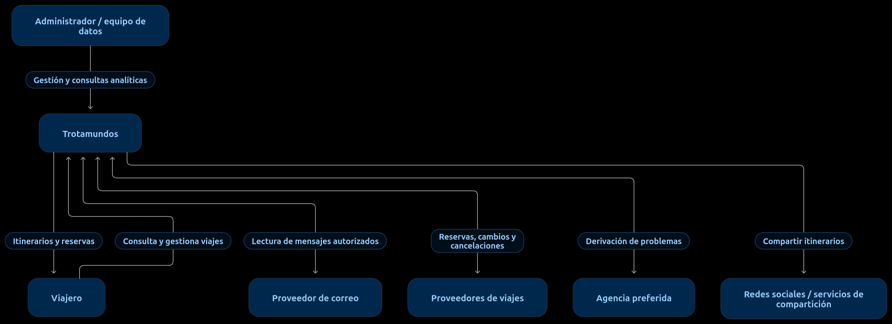

# Propósito y límites del sistema

## Propósito

Proporcionar un panel web y móvil que centralice las reservas de viajes, las agrupe por viaje y permita consultar y gestionar la información, tanto manualmente como mediante integraciones.

## Dentro del sistema

- Gestión de usuarios y acceso a la información.
- Itinerarios, viajes y reservas.
- Integraciones con proveedores de viajes.
- Procesamiento de correo y filtros de remitentes.
- Compartición controlada de itinerarios.
- Archivado o eliminación del contenido de viajes finalizados.
- Analítica de datos.
- Un módulo avanzado obligatorio, elegido aquí como propuesta inicial.

## Fuera del límite

Proveedores de correo, aerolíneas, hoteles, arrendadoras, agencias de viajes, redes sociales y servicios externos de identidad, cuando corresponda.

## Diagrama de contexto

## Cómo leerlo

El rectángulo de Trotamundos marca el sistema que vamos a diseñar; los demás elementos son actores o sistemas externos con los que interactúa.

## Límite de la información

El administrador y el equipo de datos se agrupan en el diagrama para simplificar. Sus permisos y funciones exactos no están detallados en la consigna. El diagrama representa interacciones requeridas o necesarias para los casos descritos, no una API ya implementada.

## Requisitos como drivers

- Requerimientos funcionales priorizados: [`Requerimientos_funcionales.md`](./Requerimientos_funcionales.md).
- Escenarios de atributos de calidad: [`Escenarios_de_atributos_de_calidad.md`](./Escenarios_de_atributos_de_calidad.md).
- Árbol de utilidad (priorización de escenarios para ADD): [`Utility_tree.md`](./Utility_tree.md).

## Proceso de diseño ADD

Las iteraciones del método ADD, sus vistas y decisiones se documentan en:
- [`ADD.md`](./ADD.md) — proceso ADD.
- [`Diagramas/`](./Diagramas) — vistas arquitectónicas.
- [`MADR/`](./MADR) — decisiones de diseño (formato MADR).
