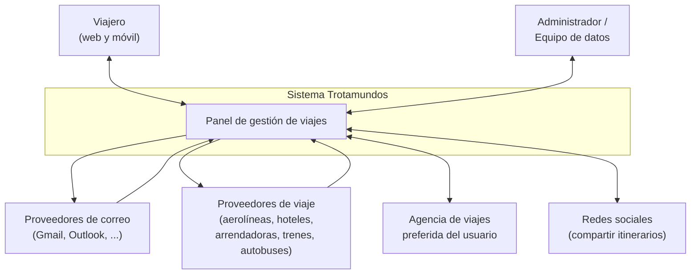

# Diagrama de contexto

Diagrama de contexto del sistema **Trotamundos**. Muestra el límite del sistema (la caja central)
y los actores o sistemas externos con los que interactúa. Se conserva además la versión gráfica
original en [`diagrama_de_contexto.png`](./diagrama_de_contexto.png).

> **Inferencia / decisión consciente.** La versión Mermaid siguiente se reconstruyó a partir de la
> descripción textual de [`../Analisis_y_pre-requisitos.md`](../Analisis_y_pre-requisitos.md) y del
> enunciado, dado que la imagen original no pudo ser leída automáticamente. No agrega actores ni
> interacciones nuevas respecto de lo ya documentado por el equipo.

## Leyenda

| Símbolo | Significado |
|---|---|
| `["Texto"]` **(rectángulo)** | Elemento con nombre: componente, módulo, servicio, cola o almacén según el límite que lo contiene |
| `[("Texto")]` **(cilindro)** | Almacén de datos o de estado: base de datos, caché, almacén analítico, sesión o registro de idempotencia |
| `(("Texto"))` **(círculo)** | Actor externo: persona o sistema situado fuera del límite del sistema |
| `subgraph` **(caja/límite)** | Límite arquitectónico: capa, módulo, región o nodo de despliegue |
| `-->` **(flecha simple)** | Flujo, llamada o publicación de mensaje en el sentido de la flecha |
| `<-->` **(flecha doble)** | Interacción bidireccional (por ejemplo, lectura y escritura sobre un almacén) |
| Flecha con texto sobre `-->` **(flecha etiquetada)** | Flujo con etiqueta: contenido, protocolo o condición del mensaje |

**Símbolos presentes en esta vista:** rectángulo, `subgraph`, `-->` y `<-->`.

## Cómo leerlo

- El rectángulo **Sistema Trotamundos** marca el sistema que se diseña.
- El resto son actores o sistemas externos que quedan **fuera del límite**.
- Las flechas indican sentidos de interacción requeridos o necesarios según los casos descritos;
  no representan una API ya implementada.

## Referencias

- [`../Analisis_y_pre-requisitos.md`](../Analisis_y_pre-requisitos.md)
- [`../ADD.md`](../ADD.md)
