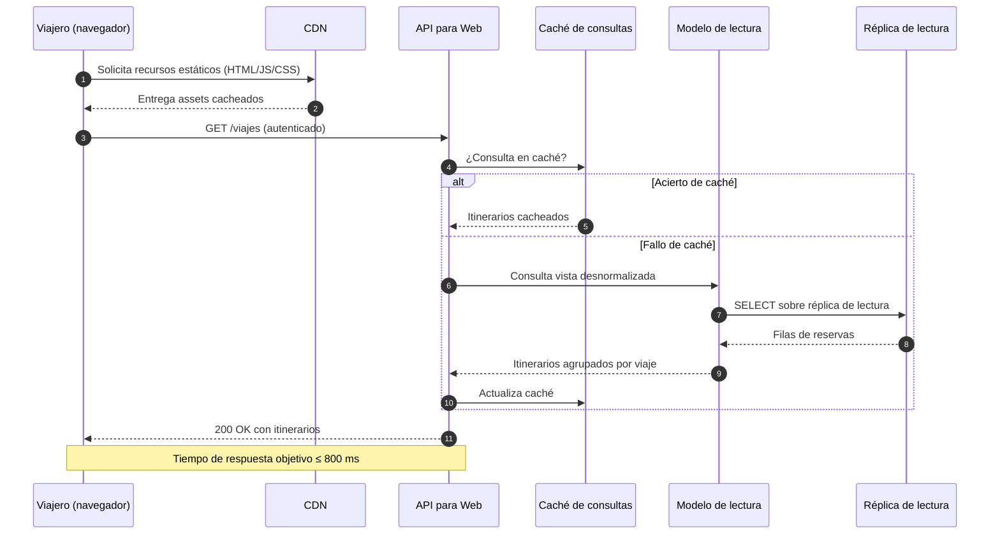

# Iteración 3 — Secuencia: consulta web con respuesta ≤ 800 ms

Diagrama de secuencia para el escenario **QA-01** (tiempo de respuesta web de 800 ms) y, en el
arranque, **QA-02** (FCP móvil < 1,4 s).

## Leyenda

| Símbolo | Significado |
|---|---|
| `participant X as Nombre` **(participante)** | Participante de la secuencia: actor, componente o sistema externo |
| `->>` **(flecha sólida)** | Mensaje o llamada enviada por el participante de origen |
| `-->>` **(flecha punteada)** | Respuesta o retorno hacia el participante de origen |
| `alt / else / end` **(bloque condicional)** | Alternativa condicional: se ejecuta solo la rama que cumple la condición |
| `Note over` **(nota)** | Anotación del escenario (restricción o regla), no un mensaje |
| `autonumber` **(numeración)** | Numeración de los pasos para seguir el orden del flujo |

**Símbolos presentes en esta vista:** `participant`, `->>`, `-->>`, `alt/else/end`, `Note over` y `autonumber`.

## Notas

- El camino de lectura evita tocar la BD primaria, reduciendo la contención.
- La CDN favorece el primer contenido visible (FCP) en móvil (QA-02).
- El caché introduce **consistencia eventual**: debe definirse un tiempo de vida (TTL) e
  invalidación ante escrituras.

> **Inferencia / decisión consciente.** La consigna no define si los 800 ms son máximo, promedio o
> percentil, ni el TTL del caché. Se adoptan valores conservadores configurables y se deja anotado
> como riesgo/brecha.

## Decisiones relacionadas
- [MADR-0008 Estrategia de caché y CDN](../MADR/MADR-0008-estrategia-cache-cdn.md)
- [MADR-0009 Modelo de lectura y réplicas](../MADR/MADR-0009-read-model-replicas.md)

## Vistas relacionadas
- [Iteración 3 — Vista de componentes y conectores de acceso](./iter3_cc_acceso.md)
