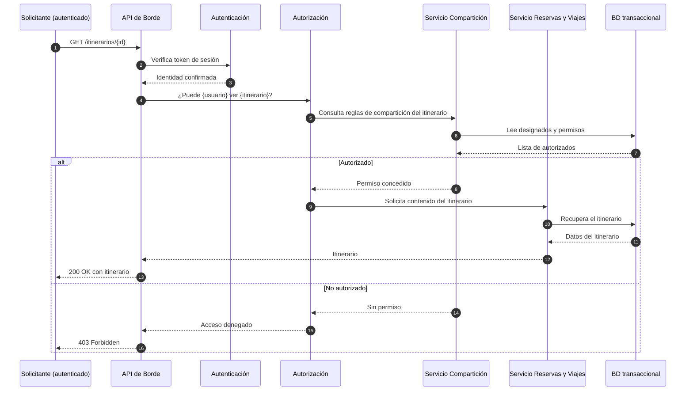

# Iteración 4 — Secuencia: acceso a un itinerario compartido

Diagrama de secuencia para el escenario **QA-07**: solo las personas específicamente designadas
pueden visualizar un itinerario.

## Leyenda

| Símbolo | Significado |
|---|---|
| `participant X as Nombre` **(participante)** | Participante de la secuencia: actor, componente o sistema externo |
| `->>` **(flecha sólida)** | Mensaje o llamada enviada por el participante de origen |
| `-->>` **(flecha punteada)** | Respuesta o retorno hacia el participante de origen |
| `alt / else / end` **(bloque condicional)** | Alternativa condicional: se ejecuta solo la rama que cumple la condición |
| `Note over` **(nota)** | Anotación del escenario (restricción o regla), no un mensaje |
| `autonumber` **(numeración)** | Numeración de los pasos para seguir el orden del flujo |

**Símbolos presentes en esta vista:** `participant`, `->>`, `-->>`, `alt/else/end` y `autonumber`.

## Notas

- La autorización se resuelve de forma centralizada y auditable.
- El acceso denegado debe registrarse en una traza de auditoría.
- El compartir itinerarios no debe exponer datos de correo ni credenciales.

## Decisiones relacionadas
- [MADR-0011 Autenticación y autorización](../MADR/MADR-0011-autenticacion-autorizacion.md)

## Vistas relacionadas
- [Iteración 4 — Vista de seguridad y analítica](./iter4_cc_seguridad_analitica.md)
